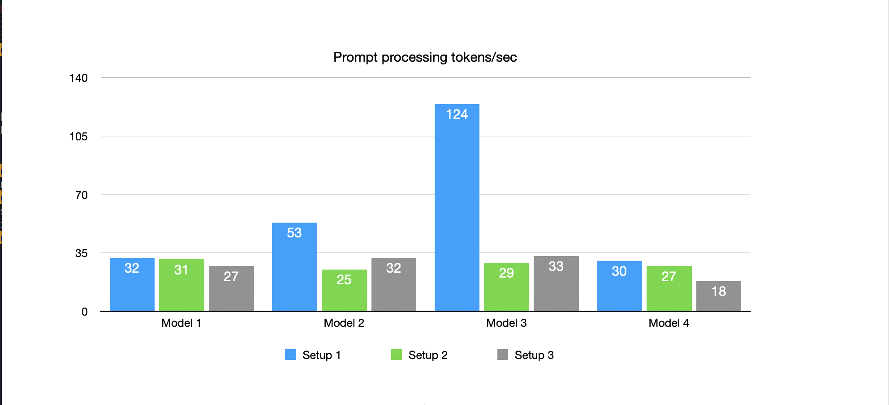
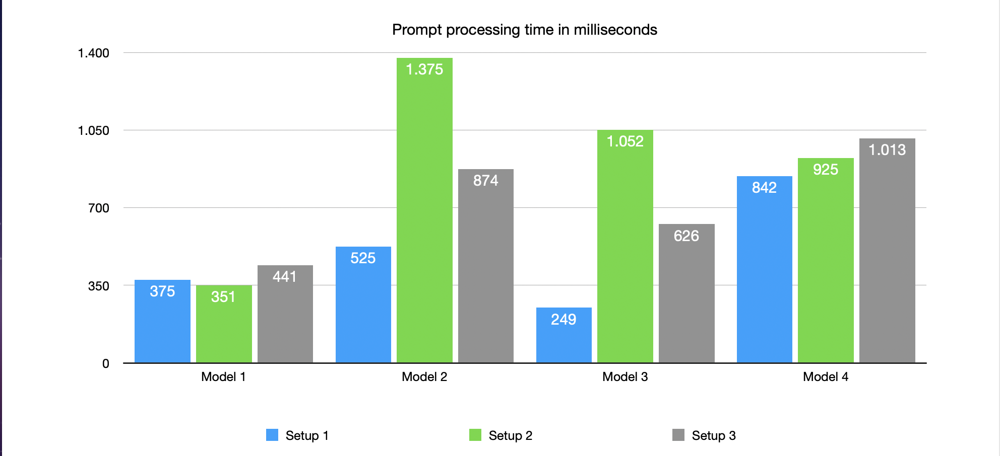
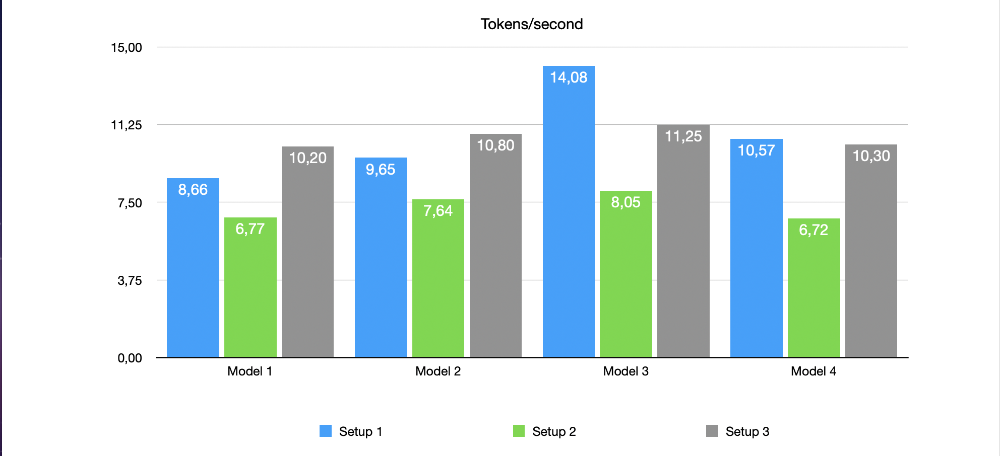
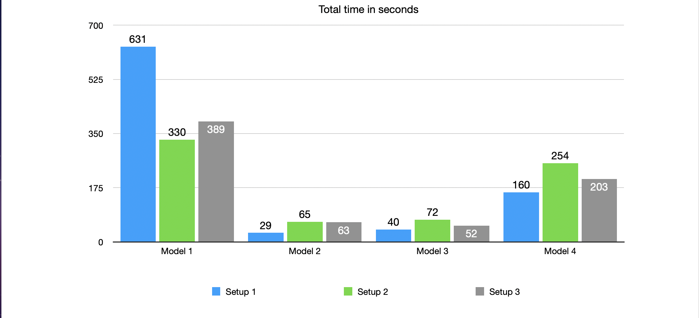
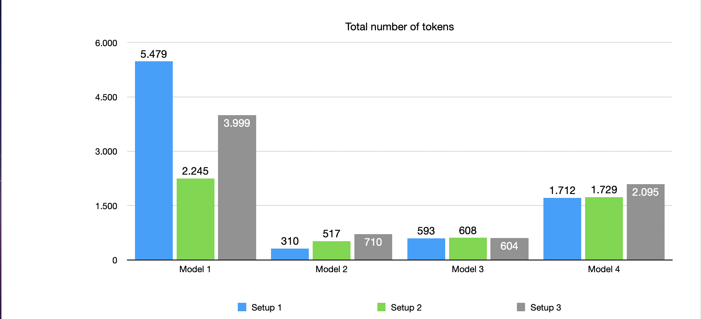

# Local AI Results

## Introduction

I am currently spending more time using **AI**, both for general tasks and for explaining **code**. I do not let the **AI** write the **code** itself. I use it as a tool.

For general questions, I use **Gemini** and **Claude**, but if I need to know something specific about **code** or workflows, I use local **AI**.

I use a simple **prompt** for these tests

	How do I implement a linked list in C

## LLM setups

In these tests, I use 3 setups with local **LLMs**:

1. MacBook Pro M1 Pro 16GB (bandwidth: 200GB/s)
2. Mac Pro 2019 W-3235 Xeon 32GB (bandwidth: 140GB/s)
3. Mac Pro 2019 W-3235 Xeon 32GB 2x Radeon 580X (bandwidth: 218GB/s)

I use the **MacBook** as a baseline to see what the other systems do. The **Mac Pro** runs without a **GPU** on **Llama.cpp** and with 2x **Radeon 580X** on **ToshLLM**.

I use **AIChat CLI** by **Sigoden** as the client.

To start the LLMs, I use the following parameters for the **Llama.cpp** command:

	llama-server -m /Users/admin/llamacpp/llama.cpp/models/gemma-4-12B-it-Q4_K_M.gguf -ngl 0 -t 10 --host 0.0.0.0 --port 8888 --perf -c 32768 -ctk q4_0 -ctv q4_0 -fa on
	
And for **ToshLLM** (only when I want to use the 2 **GPUs**):

	GGML_METAL_VRAM_RESERVE_MB=1024 GGML_METAL_DEVICE_LIST=0,1 TOSH_FA_AMD=1 TOSH_MGPU_EVENTS=1 /Applications/ToshLLM.app/Contents/Resources/bin/llama-server -m /Users/admin/llamacpp/llama.cpp/models/gemma-4-12B-it-Q4_K_M.gguf -ngl 48 -sm layer -ts 1,1 --host 0.0.0.0 --port 8888 --perf -c 32768 -ctk q4_0 -ctv q4_0 -fa on
	
## Models

I use 4 **models** for these tests, although I only use **gemma4** daily when the **LLM** needs to think and **Qwen2.5-Coder** for all other **programming** questions.

The models are:

	1. DeepSeek-R1-Distill-Qwen-14B-Q4_K_M.gguf		8.99GB
	2. Qwen2.5-Coder-14B-Q4_K_M.gguf				8.99GB
	3. gemma-1.1-7b-it-Q6_K.gguf					7.01GB
	4. gemma-4-12B-it-Q4_K_M.gguf					7.14GB

## Prompt Processing

Regarding **prompt processing**, you can see that for the **non-reasoning** model, **setup 3** is somewhat slower. When compared to **setup 1** (the baseline), you can see that even the fastest **setup 3** processes fewer tokens per second. In this case, only a simple prompt was used (no files loaded).

This is also visible in the milliseconds for **prompt processing**. **setup3** is slower than the baseline **setup 1**.

It isn't a huge difference, but it is noteworthy. You would actually expect **setup 3** to be the fastest.

## Tokens per second

In the **tokens per second**, you can see that **setup 3** does process more **tokens** per second.

It isn't a drastic difference between **setup 1** and **setup 3**. for **model 4**, **setup 3** is even slightly slower. This was an expected result because the **memory bandwidth** doesn't differ much (200GB/s for **setup 1** and 218GB/s for **setup 3**).

But what is more important to me is the difference between **setup 2** and **setup 3**, namely with or without **GPUs**. You can notice here that **setup 3** is faster. the words appear faster than one can read on **setup 3**. While on **setup 2**, you could easily read along.

Now, if you don't expect to have the speed of the **frontier models**, even **7 tokens per second** is enough to be usable. you just need a bit of patience with the **reasoning** model.

In terms of the total time from **prompt processing** to the end of the output, **setup 1** is slightly faster than **setup 3**, but again, the difference between **setup 2** and **setup 3** is more important to me (although that doesn't differ much either).

## Number of tokens generated

You can see that for the 2 most important **models**, the results are roughly equal between the **setups**. This also affects the number of **tokens per second** and the **total time**.

## Future

In the future, I would like to purchase 2x **Radeon W5700X 16GB** **GPUs**. Here, I expect to see clearly faster results because the **memory bandwidth** is higher, namely **500GB/s**. In theory, this would mean a doubling of the results, around 20 **tokens/second** and half the total time per **LLM**. The 2nd **GPU** is only there to use the same **models** but with more space for **context**. Currently, I use **32k context**, but then I might be able to go up to **128k context**.

## Conclusion

I am satisfied with my purchase of the **Mac Pro 2019 Rack** for using **local AI**. now I also use it for other things, but this was about **local AI** tests. If you really want the fastest speed, you should look at the **Mac Studio M5 Ultra or Max** if you want to stay within the **Mac** ecosystem. But because I enjoy **tinkering** with my **computers** and am also simply curious, I bought the **Mac Pro 2019 Rack**.